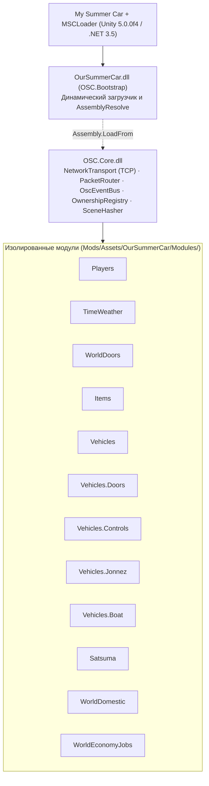

# OurSummerCar (Modular MSC Multiplayer)

Полнофункциональный кооперативный мультиплеерный мод для **My Summer Car** (MSCLoader / Unity 5.0.0f4 / `.NET 3.5`), построенный на строго изолированной модульной архитектуре.

---

## Архитектура проекта

Каждая подсистема игры вынесена в независимую сборку `OSC.Module.<Name>.dll`. Модули **не ссылаются друг на друга напрямую** — весь обмен данными идёт через ядро `OSC.Core` (`PacketRouter`, `OscEventBus`, `OwnershipRegistry`), а загрузчик `OSC.Bootstrap` (`OurSummerCar.dll`) загружает их динамически, исключая `ReflectionTypeLoadException` при старте MSCLoader.



### Состав решения (`src/OurSummerCar.sln`, 14 проектов)

| Сборка | Этап | Назначение | Диапазон `PacketType` |
| --- | --- | --- | --- |
| `OurSummerCar.dll` (`OSC.Bootstrap`) | База | Точка входа MSCLoader без статических зависимостей от `OSC.Core` | — |
| `OSC.Core.dll` | База | TCP-транспорт, `PacketRouter`, `OscEventBus`, `OwnershipRegistry`, `PlayMakerBridge`, `SceneHasher` | `1..2` (`Ping`/`Pong`) |
| `OSC.Module.Players.dll` | Этап 1 | 3D-кукла игрока (`clothes.unity3d`), IK рук/головы, приседания, жесты, пиво, мочеиспускание, сон, мат | `3..4`, `20..24` |
| `OSC.Module.TimeWeather.dll` | Этап 1 | Время 1:1 (дни, часы, минуты, стрелки `SuomiClock`), погода, облака, гроза, принудительный ресинк после сна | `40` |
| `OSC.Module.WorldDoors.dll` | Этап 1 | Двери дома и гаражные створки с кинематической интерполяцией и Late-Join снимком | `50..52` |
| `OSC.Module.Items.dll` | Этап 2 | Подбор/перенос/бросок предметов, ящики пива, расходники, пакеты магазина, канистры, инструменты, домкрат, сканер чит-спавна | `90..92` |
| `OSC.Module.Vehicles.dll` | Этап 2 | Шасси 9 видов транспорта, посадка за руль, кастомные пассажирские места, руль, толкание (`J`), коллизии кузова | `60..61`, `66..68` |
| `OSC.Module.Vehicles.Doors.dll` | Этап 3 | Двери Hayosiko (включая сдвижную и заднюю), двери/капоты/багажники Satsuma, Gifu, Ferndale, Ruscko без пинг-понга | `62..65` |
| `OSC.Module.Vehicles.Controls.dll` | Этап 3 | Приборка, свет, дворники, гудок, обороты/`SoundController`, 8 топливных баков, радио/CD, буксировка, лебёдка Gifu, повреждения, `PhysicsOptimizer` | `69`, `71..75` |
| `OSC.Module.Vehicles.Jonnez.dll` | Этап 3 | Физика мопеда Jonnez, фикс падения/улёта, коллизии куклы, подножка, шлем, погрузка в кузов Hayosiko | `76` |
| `OSC.Module.Vehicles.Boat.dll` | Этап 3 | Подвесной мотор лодки (тросик, передача, газ, румпель), швартовка к причалу, защита пассажира при выходе/глушении | `70`, `77` |
| `OSC.Module.Satsuma.dll` | Этап 4 | Сборка/снятие 130+ деталей, болты (0..8), тюнинг (клапаны, зажигание, карбюратор, ремень, развал), жидкости/износ, Флетари, каталог, техосмотр | `93..99` |
| `OSC.Module.WorldDomestic.dll` | Этап 5 | Кооперативный сон (4 ванильных + 6 кастомных мест), свет/щиток/вода, сауна (`CheckPeeOnSauna`), пожар дома, готовка на гриле, осы, крышки/пробки | `25`, `110..113` |
| `OSC.Module.WorldEconomyJobs.dll` | Этап 6 | Общий кошелёк, магазин Теймо/АЗС/ограбление, паб и азартные игры, работы (Gifu, Kekmet, Kilju, клубника, комбайн), телефон/квесты, трафик NPC/полиция/ралли, сохранения в туалете и возрождение без разрыва сессии | `130..135` |

---

## Установка и подключение в игре

### Быстрая установка (рекомендуется)
1. Скачайте готовый релизный архив (`OurSummerCar-Mod.zip` или версию из `Release/backups/`).
2. Распакуйте архив в любую временную папку.
3. Запустите `install.bat` — скрипт автоматически скопирует в `Documents\MySummerCar\Mods\` (или папку Steam при отсутствии):
   - `Mods\OurSummerCar.dll`
   - `Mods\Assets\OurSummerCar\Core\OSC.Core.dll`
   - `Mods\Assets\OurSummerCar\Modules\OSC.Module.*.dll` (все 12 модулей)
   - `Mods\Assets\OurSummerCar\clothes.unity3d` и `wreckmp.unity3d`

### Ручная установка
Скопируйте папку `Mods` из распакованного архива в `Documents\MySummerCar\` с заменой файлов. Убедитесь, что у **Хоста и Клиента установлена строго одинаковая версия мода**.

### Как играть по сети (Radmin VPN / LAN)
1. Запустите My Summer Car с установленным MSCLoader (меню мода появляется автоматически; `F10` — скрыть или открыть окно).
2. Объединитесь в одну виртуальную сеть (например, **Radmin VPN**, IP вида `26.x.x.x`) или локальную сеть; порт по умолчанию — **`7777`** (TCP).
3. **Хост:** выберите никнейм, загрузите мир, нажмите **«Запустить Хост»** (или включите **«Автозапуск сервера при входе в мир»**).
4. **Клиент:** откройте меню (`F10`), введите никнейм, в поле **IP** укажите Radmin/LAN IP хоста, загрузите мир и нажмите **«Подключиться»**.
5. При сохранении игры в туалете Хост отправляет файл сохранения Клиенту по сети с проверкой целостности (CRC32) и автоматическим `.bak`-бэкапом.

---

## Совместимость с BetterCheatBox и читами
- **Телепортация (`> 10 м` / `> 6 м`):** мгновенный перенос без Lerp-хвостов, обнуление линейной/угловой скорости шасси, подавление ложного спама столкновений, руля и дверей.
- **Автосборка Satsuma:** периодический дайджест `SceneHasher` и болтов обнаруживает массовую установку/затяжку и автоматически рассылает `PartAssembleSnapshot`.
- **Топливо и жидкости:** скачок объёма `> 0.5 л` рассылается напарнику немедленно, минуя фоновый троттлинг.
- **Спавн предметов и NoClip:** сканер `ScanCheatSpawnedItems` регистрирует новые предметы вокруг игрока, а кукла при NoClip плавно следует по координатам.

---

## Сборка из исходников и упаковка

Требуется установленный **.NET SDK** и копия игры My Summer Car (путь к `Managed` и `Mods` задаётся в [Directory.Build.props](file:///c:/me/Antigravity%20projects/OurSummerCar/src/Directory.Build.props)).

```powershell
# Сборка всех 14 проектов в Release и авто-деплой в Documents\MySummerCar\Mods\
dotnet build src\OurSummerCar.sln -c Release

# Создание релизного ZIP-архива с версией и install.bat
powershell -ExecutionPolicy Bypass -File package_mod.ps1 -VersionTag v1.0.0
```

> Подробные правила разработки, изоляции модулей и ограничения Unity 5.0.0f4 / `.NET 3.5` зафиксированы в [ORCHESTRATOR.md](file:///c:/me/Antigravity%20projects/OurSummerCar/ORCHESTRATOR.md).

---

## Версии, теги и откат

Каждый завершённый этап зафиксирован отдельным тегом Git и резервным ZIP-архивом в `Release/backups/`:

| Тег | Описание | Архив |
| --- | --- | --- |
| `v0.3.0-stage3` | Завершён Этап 3 (`Vehicles.Doors`, `Vehicles.Controls`, `Vehicles.Jonnez`, `Vehicles.Boat`) | `Release/backups/OurSummerCar-v0.3.0-stage3.zip` |
| `v0.3.1-stage4-prep` | Расширены контракты `PacketType` и `BridgeEvents` под Этапы 4–6, модульный `package_mod.ps1` | — |
| `v0.4.0-stage4` | Добавлен Этап 4 (`OSC.Module.Satsuma`: сборка, болты, тюнинг, жидкости, Флетари, Линделл) | `Release/backups/OurSummerCar-v0.4.0-stage4.zip` |
| `v0.5.0-stage5` | Добавлен Этап 5 (`OSC.Module.WorldDomestic`: сон 4+6 мест, электричество, сауна, пожар, быт) | `Release/backups/OurSummerCar-v0.5.0-stage5.zip` |
| `v0.6.0-stage6` | Добавлен Этап 6 (`OSC.Module.WorldEconomyJobs`) + финал аудита `InsertAction`/Ownership | `Release/backups/OurSummerCar-v0.6.0-stage6.zip` |
| `v1.0.0` | Полный модульный релиз (все 6 этапов), финальная документация и `OurSummerCar-Mod.zip` | `Release/backups/OurSummerCar-v1.0.0.zip` |

Для отката кода к нужному этапу:
```powershell
git checkout v0.3.0-stage3   # или v0.4.0-stage4 / v0.5.0-stage5 / v0.6.0-stage6 / main
dotnet build src\OurSummerCar.sln -c Release
```
